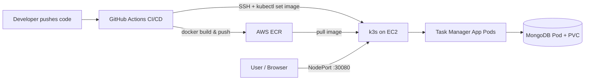

# Task Manager — End-to-End DevOps Portfolio Project

A simple Task Manager REST API, deployed with a complete DevOps pipeline:
**Docker → Kubernetes (k3s on AWS EC2) → Terraform (IaC) → GitHub Actions (CI/CD)**.

The app itself is intentionally simple. The point of this project is the infrastructure
and automation around it — provisioning, containerization, orchestration, and deployment —
which is what the skills below actually demonstrate.

## Architecture



- **App**: Node.js + Express REST API, MongoDB for storage
- **Containerization**: Multi-stage Dockerfile, non-root user, built-in HEALTHCHECK
- **Orchestration**: Kubernetes manifests — Deployment, Service, ConfigMap, PersistentVolumeClaim,
  readiness/liveness probes, rolling update strategy
- **Infrastructure as Code**: Terraform provisions the EC2 instance, security group, and ECR repository;
  k3s (lightweight Kubernetes) is installed automatically via a user-data bootstrap script
- **CI/CD**: GitHub Actions builds the Docker image on every push to `main`, pushes it to ECR,
  then deploys it to the cluster via a rolling update over SSH

## Why k3s instead of EKS

EKS costs ~$73/month just for the control plane before any compute. k3s gives you a fully
functional Kubernetes API (same `kubectl` commands, same manifests) running on a single EC2
instance for a few dollars a month — the right tradeoff for a portfolio project. The k8s
manifests in this repo would work unchanged against a real EKS cluster if you ever needed to
scale this up.

## Project structure

```
taskmanager-devops/
├── app/                    # Node.js app + Dockerfile
├── k8s/                    # Kubernetes manifests
├── terraform/              # Infrastructure as Code
├── .github/workflows/      # CI/CD pipeline
└── docker-compose.yml      # Local dev environment
```

## Running it yourself

### 1. Local development (no AWS needed)
```bash
docker compose up --build
curl http://localhost:3000/health
curl -X POST http://localhost:3000/api/tasks -H "Content-Type: application/json" \
  -d '{"title":"Learn Terraform","status":"in-progress"}'
curl http://localhost:3000/api/tasks
```

### 2. Provision real infrastructure
```bash
cd terraform
terraform init
terraform apply -var="key_pair_name=<your-existing-aws-keypair>"
# Note the outputs: instance_public_ip and ecr_repository_url
```

### 3. Deploy to the cluster
```bash
# SSH in and pull the kubeconfig to your local machine
ssh ec2-user@<instance_public_ip> "sudo cat /etc/rancher/k3s/k3s.yaml" > kubeconfig.yaml
# Edit kubeconfig.yaml: replace 127.0.0.1 with <instance_public_ip>
export KUBECONFIG=./kubeconfig.yaml

kubectl apply -f k8s/
kubectl get pods -n taskmanager
```

### 4. Set up CI/CD
Add the 4 GitHub secrets listed at the bottom of `.github/workflows/deploy.yml`, then push to `main`.
Every push rebuilds, pushes to ECR, and rolls out automatically.

## What this project actually proves (for your resume / interviews)

- Wrote a multi-stage **Dockerfile** following security best practice (non-root user, health checks)
- Designed **Kubernetes manifests** with proper resource limits, readiness/liveness probes, and
  a rolling update strategy with zero downtime (`maxUnavailable: 0`)
- Used **PersistentVolumeClaims** to handle stateful storage for MongoDB inside Kubernetes
- Provisioned real cloud infrastructure with **Terraform** — EC2, security groups, ECR — using
  variables, outputs, and data sources instead of hardcoded values
- Built a working **CI/CD pipeline** in GitHub Actions: automated build, push to a private
  container registry, and remote rolling deployment on every commit
- Made a deliberate **cost/architecture tradeoff** (k3s vs EKS) and can explain why

### Suggested resume bullet points
- "Built and deployed a containerized REST API on self-managed Kubernetes (k3s) running on AWS
  EC2, provisioned entirely via Terraform."
- "Designed a CI/CD pipeline with GitHub Actions that automates Docker image builds, pushes to
  AWS ECR, and performs zero-downtime rolling deployments to Kubernetes."
- "Implemented Kubernetes best practices including readiness/liveness probes, resource limits,
  and persistent storage for a stateful MongoDB workload."

## Cost note
Running this continuously costs roughly $15–25/month (t3.medium EC2 + EBS volume). Run
`terraform destroy` when you're not actively using it for demos or interviews.
